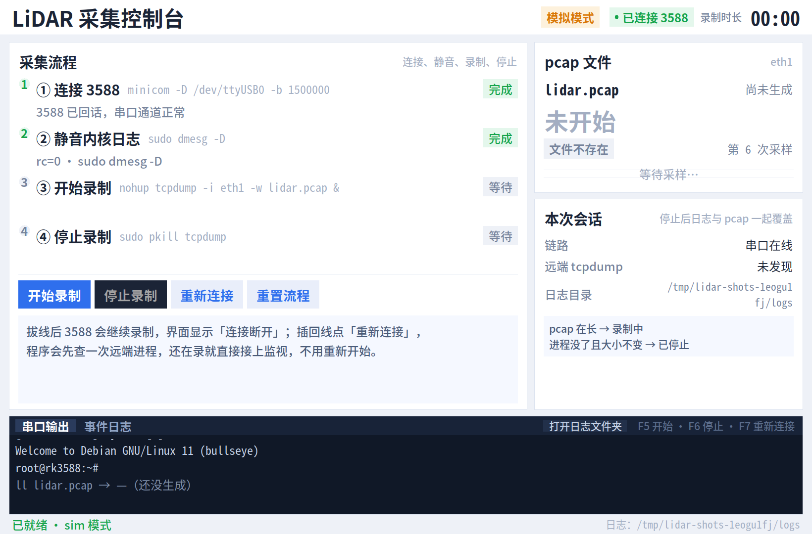
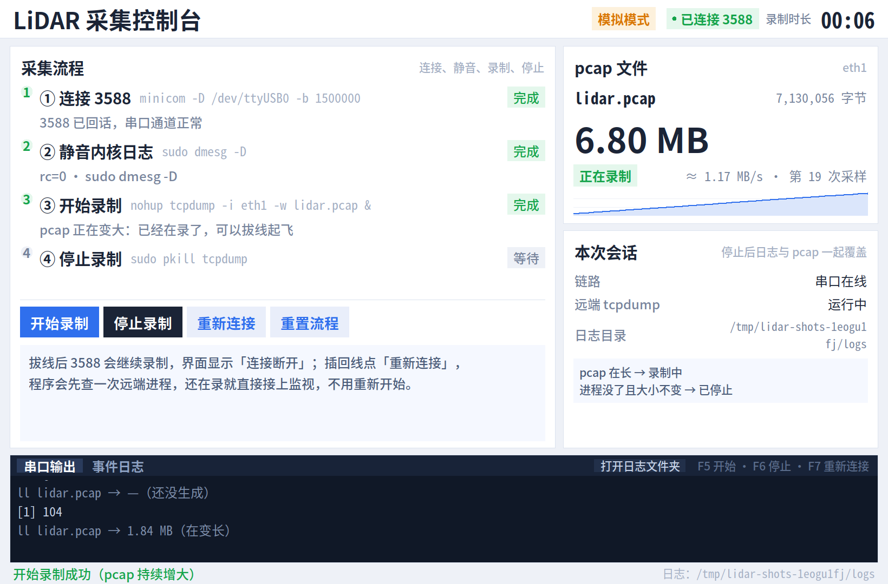
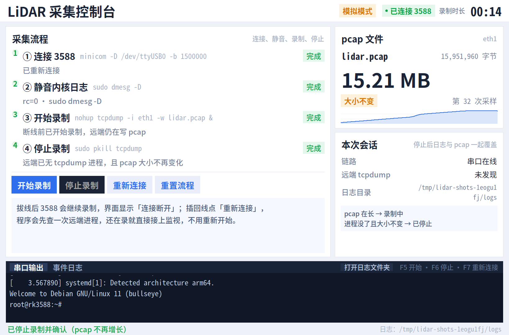
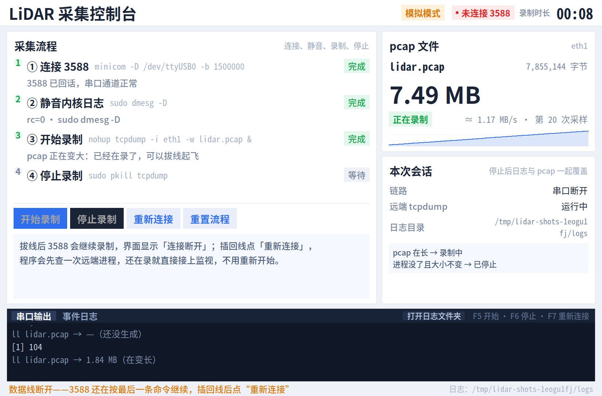
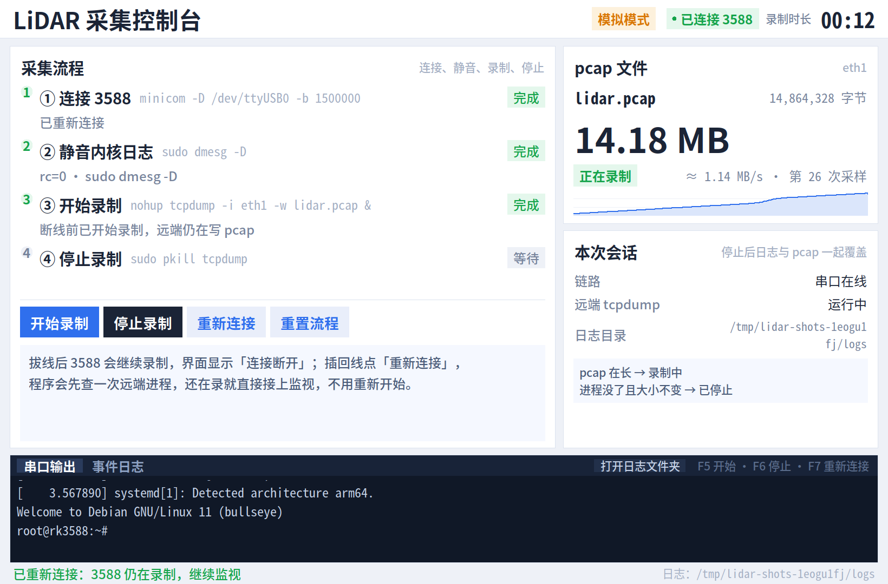

# LiDAR 采集控制台

[](https://github.com/loudeyi/lidar-capture/actions/workflows/tests.yml)
[](LICENSE)

把无人机采集 LiDAR 的那套手工流程——**插线 → minicom → 关内核打印 → tcpdump 录制 → 看 pcap 长不长 → 拔线起飞 → 落地插线 → kill tcpdump → 确认停了**——做成一个有独立窗口、能看进度的工具。

判定不靠猜：

- **pcap 持续变大 = 正在录制**
- **远端 `pgrep -x tcpdump` 找不到且 `ll` 大小不再变化 = 已停止**
- 拔线不影响飞行中的 3588（它还在录），插回来点「重新连接」就先查一次远端进程，还在录就直接接上监视

界面用 Python + Tkinter 写成，**不装任何第三方包**；真机、模拟两条链路只换传输层，判定逻辑完全一样。

## 截图



| 录制中 | 已停止 |
| --- | --- |
|  |  |

拔线时状态栏变红「未连接」，但 3588 还在录、计时继续走；插回去点「重新连接」自动接管：

| 拔线 | 重新连接 |
| --- | --- |
|  |  |

窗口按屏幕大小自适应（最大 1640×1080）；按钮也可以走快捷键 `F5` 开始 / `F6` 停止 / `F7` 重新连接。

## 两个入口脚本

| 脚本 | 模式 | 用途 |
| --- | --- | --- |
| `./run.sh` | `--profile real` | **工作模式**：接真机 3588（`/dev/ttyUSB0` + `eth1`） |
| `./run_demo.sh` | `--profile sim` | **演示模式**：本机 pty 上跑一个假 3588，不需要任何硬件 |

两个脚本都会把参数原样传给 `main.py`，所以还能临时覆盖默认值：

```bash
./run.sh --device /dev/ttyUSB1 --interface eth0   # 换串口/网口
./run_demo.sh --scenario no_traffic               # 演示“命令发出但 pcap 不变大”
./run_demo.sh --demo                              # 自动演一遍：连接→录制→停止
```

> `python3 main.py` 也能直接跑，默认是 `sim`（开发时方便）；正式采集请用 `./run.sh`。

## 环境要求

- Python 3.8+，带 Tkinter（Debian/Ubuntu：`sudo apt install python3-tk`）
- 真机模式额外需要：`minicom`、3588 上的 `tcpdump`，以及能免密执行 `sudo dmesg -D` / `sudo pkill tcpdump`
- 3588 连上串口后直接就是 shell，登录后的当前目录就是 `lidar.pcap` 所在目录

```bash
git clone https://github.com/loudeyi/lidar-capture.git
cd lidar-capture
./run_demo.sh          # 先看演示，确认界面正常
./run.sh               # 接真机开始采集
```

## 四步与判定规则

| 步骤 | 实际命令 | 成功标准 |
| --- | --- | --- |
| ① 连接 | `minicom -D /dev/ttyUSB0 -b 1500000` | 3588 回了一个独行 `__PING__` |
| ② 静音 | `sudo dmesg -D` | 退出码 0，失败就拦住录制 |
| ③ 录制 | `nohup tcpdump -i eth1 -w lidar.pcap &` | 每 2 秒 `ll lidar.pcap`，窗口内持续变大 |
| ④ 停止 | `sudo pkill tcpdump` | `pgrep -x tcpdump` 没了，且 `ll` 大小不再变化 |

- 每条命令都包了 `echo __B<n>__ … echo __RC<n>__ $? … echo __E<n>__` 三行标记，靠整行匹配定位输出，不会被串口刷屏里的无关字符骗到。
- 停止最多重试 `stop_timeout`（默认 12 秒），期间把「第几次确认、进程在不在、pcap 多大」写进事件页；确认不了就明确显示**停止失败**，不假装成功。
- 「串口输出」页只留人看的东西：连接横幅、`dmesg` 结果、`[1] 101` 回执，以及**结论变化时**的一行证据（如 `ll lidar.pcap → 3.07 MB（在变长）`）。协议标记、轮询回显都过滤掉了，不会刷屏。
- 采集文件名固定 `lidar.pcap`，**覆盖式**；重新开始录制会覆盖上一段数据和上一轮日志。

## 演示模式是真的在跑

不是假动画：用 `pty` 起真 `bash`，`PATH` 里塞了假的 `tcpdump / pgrep / pkill / sudo / dmesg / ll`，`lidar.pcap` 是真文件、真增长；“拔线”就是关掉 pty 主端——假 `tcpdump` 因为 `nohup` 还活着，重新“插线”后新 bash 里 `pgrep` 仍能找到它，和真机行为一致。

预置场景：`normal`、`no_traffic`（命令发出但没上包）、`stall_then_grow`（先卡住再开始）、`stuck`（pkill 杀不掉）、`dmesg_fail`（第二步失败）。

## 日志与产物

全部在项目目录下，**每次开始录制都覆盖上一轮**（和 pcap 一样）：

```
logs/session.log   完整串口记录（含开始前的连接阶段）
logs/events.jsonl  结构化事件：link_open / start / recording / stopped / stop_failed …
logs/summary.md    本轮结果：时长、大小、平均速率、原因
runtime/lidar.pcap 演示模式下假 3588 的录制文件
```

## 配置

首次运行会在项目根目录生成 `config.toml`（已在 `.gitignore` 里，不会进仓库）：

| 键 | 默认 | 说明 |
| --- | --- | --- |
| `profile` | `sim` | `sim` / `real`，会被入口脚本覆盖 |
| `device` / `baud` | `/dev/ttyUSB0` / `1500000` | 串口 |
| `interface` | `eth1` | tcpdump 录制的网口 |
| `remote_file` / `remote_dir` | `lidar.pcap` / 空 | 远端文件名与目录 |
| `console` | `minicom` | `minicom`（外部）/ `native`（内置 termios） |
| `auto_connect` | `true` | 连上后自动执行 `sudo dmesg -D` |
| `poll_interval` | `2.0` | pcap 采样间隔（秒） |
| `start_timeout` / `stop_timeout` | `30` / `12` | 等上包 / 等停止的上限 |

命令行参数优先于配置文件，例如 `./run.sh --poll 1`。

## 测试

```bash
python3 -m unittest discover -s tests -v     # 44 个用例，约 23 秒
```

- 单元测试：配置往返、大小滑动窗口、标记解析、假 shell、`ll` 输出解析、协议回声过滤、证据行规则
- 端到端（`tests/test_sim_integration.py`）：正常录制 → 停止确认 → 日志覆盖 → 拔线重连 → 停止卡住报错 → 没上包超时 → `dmesg` 失败拦截

CI 在 GitHub Actions 上跑同一套（`.github/workflows/tests.yml`）。

## 目录

```
main.py                       入口（参数解析 → 配置文件 → 界面）
run.sh / run_demo.sh          工作模式 / 演示模式
lidar_capture/config.py       配置与命令模板
lidar_capture/protocol.py     串口协议：标记、超时、拔线检测
lidar_capture/transports.py   minicom / termios / 模拟三种链路
lidar_capture/sim.py          假 3588（pty + 真 bash + 假命令）
lidar_capture/sim_tcpdump.py  假 tcpdump（真写 pcap）
lidar_capture/controller.py   状态机与全部判定
lidar_capture/monitor.py      大小滑动窗口
lidar_capture/events.py       会话日志（覆盖式）
lidar_capture/ui.py           Tkinter 界面
tools/shoot.py                连拍界面截图
docs/shots/                   界面截图
tests/                        单元测试 + 端到端模拟测试
```

## 常见问题

- **第二步一直红**：3588 上 `sudo` 需要密码，先手动 `sudo -v` 或配好免密。
- **`/dev/ttyUSB0` 打不开**：minicom 被别的窗口占着，或设备名不是这个（`ls /dev/ttyUSB*`）。
- **`eth1` 不存在**：`ip link` 看实际网口，改 `--interface`。
- **窗口太大/太小**：默认取屏幕的 94%（上限 1640×1080），直接拖边角也能改。
- **想手动敲命令**：界面目前只提供四步按钮；调试可以调 `controller.manual("…")`。

## 许可证

[MIT](LICENSE) © 2026 loudeyi
